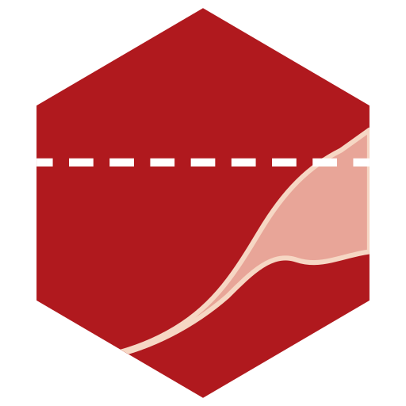
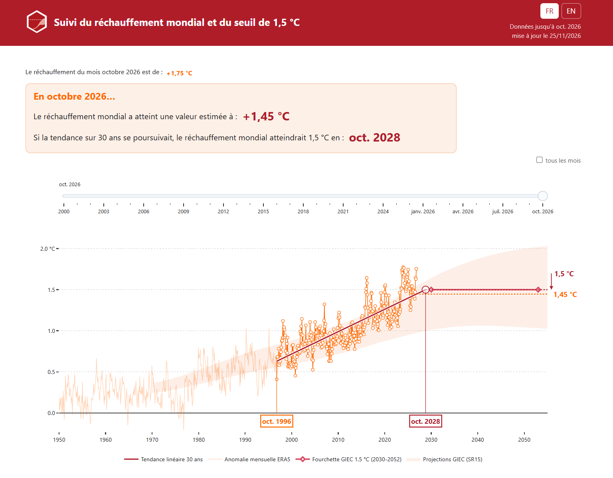

<div align="center">



[](https://github.com/Alliages/suivi-rechauffement-global/actions/workflows/mise-a-jour.yml)
[](CHANGELOG.md)
[](LICENSE)
[](requirements.txt)
[](https://alliages.github.io/suivi-rechauffement-global/)

# Suivi du réchauffement mondial et du seuil de 1,5 °C

**Le réchauffement mondial face au seuil de 1,5 °C, suivi mois par mois.**

Outil libre qui reprend la méthode du [Global Temperature Trend Monitor](https://apps.climate.copernicus.eu/global-temperature-trend-monitor/) de Copernicus C3S, dont l'application officielle n'est plus mise à jour depuis août 2026. Il est réimplémenté pour se mettre à jour **automatiquement chaque mois** et ajoute des exports : données, images, GIF animés et script PowerShell.

[Page en ligne](https://alliages.github.io/suivi-rechauffement-global/) · [Méthode](#méthode) · [Organisation](#organisation) · [Mise à jour](#mise-à-jour) · [Exports](#exports) · [Développement local](#développement-local) · [Roadmap](ROADMAP.md) · [Changelog](CHANGELOG.md)



</div>

> Outil non officiel, ni produit ni approuvé par Copernicus.

## Méthode

| Étape | Détail |
|---|---|
| Données | Température de l'air à 2 m, moyenne mondiale quotidienne ERA5 ([Copernicus Climate Pulse](https://pulse.climate.copernicus.eu/)), CSV public, sans compte |
| Mensuel | Moyenne des anomalies quotidiennes (réf. 1991-2020), mois complets uniquement |
| Préindustriel | Ajout d'un écart mensuel fixe 1991-2020 → 1850-1900 (`MONTHLY_OFFSETS`, bulletin C3S) |
| Tendance | Régression linéaire sur 361 mois (30 ans), comme le notebook officiel |
| Date 1,5 °C | Début de fenêtre + `int((1,5 − c) / m)` mois : extrapolation, pas une prévision |
| Curseur | Un pas par année depuis 2000 (fenêtre finissant en décembre), puis les 12 derniers mois |

Écart avec l'outil officiel : celui-ci part des moyennes mensuelles ERA5 du Climate Data Store (compte requis). Ici, on moyenne la série quotidienne de Climate Pulse. L'écart attendu est de l'ordre du centième de degré.

## Organisation

```
pipeline/config.py        toutes les constantes (sources, méthode, contrôles, rendu, palette)
pipeline/compute.py       moyennes mensuelles, anomalies, tendances, contrôles qualité
pipeline/main.py          téléchargement → calculs → data/ → _site/
pipeline/download.py      téléchargements HTTP
pipeline/content.py       assemble data/content.json depuis content_src.json
pipeline/content_src.json textes des onglets FAQ, Glossaire, Code source (FR/EN)
pipeline/render.py        images PNG/SVG/JPG/PDF et GIF (matplotlib)
index.html                structure de la page
app.js, style.css         script et styles de la page (Plotly.js embarqué dans vendor/)
data/                     données calculées, versionnées à chaque mise à jour
scripts/export.ps1        export d'images / GIF depuis Windows
tests/                    tests de la méthode, du pipeline et du rendu + données synthétiques
```

Pour modifier un texte de la FAQ ou du glossaire, éditer `pipeline/content_src.json` ; les champs `{offsets_table}` et `{annual_offset}` sont remplis depuis `config.py`.

## Mise à jour

Tout est automatique : le workflow **Mise à jour mensuelle** tourne le 5 de chaque mois. Il télécharge les données, contrôle leur cohérence, commite `data/` si quelque chose a changé, régénère images et GIF, puis publie la page.

- **Lancer à la main :** onglet *Actions* → *Mise à jour mensuelle* → *Run workflow*.
- **En cas d'échec :** GitHub envoie un e-mail. Les contrôles qualité (valeurs hors bornes, mois disparus, révision d'un mois final de plus de 0,05 °C) bloquent la publication, et la page précédente reste en ligne.
- **Si Copernicus change une URL ou un nom de colonne :** il suffit de modifier `pipeline/config.py`. Le lecteur de colonnes de `compute.py` cherche les préfixes `date`, `2t`, `ano` et `status`.
- **Dépendances :** Dependabot propose chaque mois les mises à jour (pip et actions) en pull request ; le job `audit` du workflow (`pip-audit`) signale les vulnérabilités connues sans bloquer la publication.
- **Dépôt inactif :** GitHub suspend les tâches planifiées après 60 jours sans activité. Les commits mensuels de données suffisent normalement à l'éviter. Si la mise à jour s'arrête, il suffit de réactiver le workflow dans l'onglet *Actions*.

### Mise en route (une seule fois)
*Settings* → *Pages* → *Source* : **GitHub Actions**, puis lancer le workflow à la main.

## Exports

Sur la page :
- graphique de la vue courante en PNG ou SVG ;
- données en CSV (série mensuelle, tendances, enveloppe GIEC) et en JSON ;
- GIF et archives ZIP d'images, précalculés chaque mois.

### Depuis Windows : `scripts/export.ps1`

```powershell
# Fichiers précalculés (rien à installer)
.\export.ps1                                   # GIF + images des 2 animations dans .\exports
.\export.ps1 -Mode gif -Animation extrapolation

# Génération locale, tous réglages (Python 3.10+ requis, installé dans .venv au 1er lancement)
.\export.ps1 -Local -Mode frames -Animation courbe -Debut 2000-01 -Format svg -Dossier .\images
.\export.ps1 -Local -Mode gif -Debut 2010-01 -Pas 2 -Fps 6 -Largeur 1920 -Hauteur 1080 -Langue en
```

| Paramètre | Valeurs | Défaut |
|---|---|---|
| `-Mode` | `frames` (images), `gif`, `both` | `both` |
| `-Animation` | `courbe`, `extrapolation`, `both` | `both` |
| `-Local` | génère sur le poste (sinon télécharge) | non |
| `-Debut`, `-Fin` | mois `AAAA-MM` | toute la période |
| `-Pas` | un mois sur N | 1 |
| `-Fps` | images par seconde du GIF | 8 |
| `-Format` | `png`, `svg`, `jpg`, `pdf` | `png` |
| `-Largeur`, `-Hauteur` | pixels | 1280 × 720 |
| `-Langue` | `fr`, `en` (aussi pour les fichiers précalculés) | `fr` |
| `-Dossier` | dossier de sortie | `.\exports` |

Le script fonctionne aussi seul, sans cloner le dépôt : il télécharge alors `render.py`, `config.py` et `download.py` depuis le commit indiqué dans `-RawUrl` (SHA fixe, à mettre à jour après chaque version). Si Windows bloque son exécution, lancer `powershell -ExecutionPolicy Bypass -File .\export.ps1`.

Animations :
- **courbe** : les anomalies mensuelles se tracent mois après mois ;
- **extrapolation** : la fenêtre de 30 ans avance, avec la tendance et la date d'atteinte de 1,5 °C.

## Développement local

```bash
pip install -r requirements.txt
python -m pytest -q tests
python pipeline/main.py --site            # télécharge et calcule, page dans _site/
python -m http.server -d _site 8000       # http://localhost:8000
python pipeline/render.py --help          # options de rendu
```

Pour tester hors ligne : `python tests/make_fixture.py /tmp/fx`, puis `--daily /tmp/fx/daily.csv`. Ces données sont **synthétiques** et ne doivent pas être commitées dans `data/`.

## À venir

Détail dans [ROADMAP.md](ROADMAP.md).

## Sources et crédits

- ERA5 : Hersbach et al. (2020), *Q. J. R. Meteorol. Soc.*, doi:10.1002/qj.3803. Copernicus Climate Change Service / ECMWF.
- Méthode : C3S Global Temperature Trend Monitor (notebook « source code »).
- Projections : GIEC, rapport spécial 1,5 °C (SR15), 2018.
- Icônes : Tabler Icons (licence MIT).
- Plotly.js (licence MIT), embarqué dans `vendor/`.

## Conventions de la page

- `app.js` utilise `innerHTML` uniquement sur ses propres libellés FR/EN ou sur des données générées par le pipeline (`data/series.json`, `data/content.json`). Aucune entrée utilisateur n'y est injectée. La CSP de `index.html` n'autorise que les scripts servis par le site lui-même : pas de script inline dans la page, pas de `onclick=`, pas de CDN.
- Tous les réglages viennent de `config.py` via `series.json` (`config.colors`, `x_view`, `grid_step`, `export_size`, `days_per_month`, `meta.trend_years`, `meta.monthly_offsets`), sans valeur recopiée dans la page ; `data/content.json` porte les textes des onglets.

Version : **1.3** ([CHANGELOG](CHANGELOG.md))
